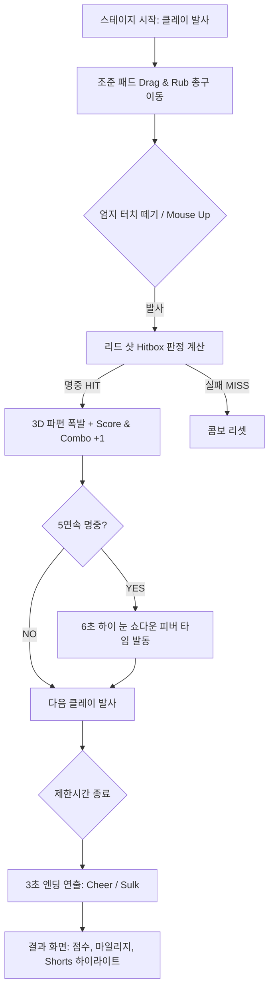
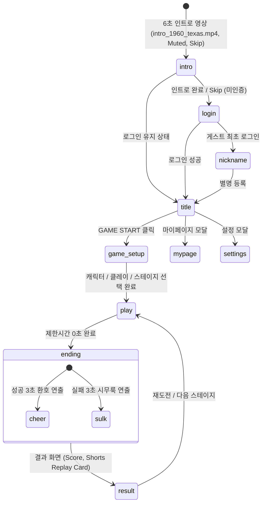

# 🎯 3D 아케이드 클레이 슈팅 게임 『Claypop Version 2』 Master Design Doc (v2.0)
*Universal Mini-Game Design Document — Claypop Version 2 Edition (Form_1_7 Compliant)*
***표준 규격 참조: 미니게임 표준 기획서 Form_1_7 (Vite 8 + Three.js 0.186 + Phaser 3.80 + Firebase 13)***

---

## 0. 문서 개요 및 사용 지침

### 0.1 문서의 목적 및 기본 원칙
본 문서는 3D 아케이드 클레이 슈팅 게임 **『Claypop Version 2』(영문 식별자: `claypopv2`)**의 개발을 위한 최상위 종합 게임 디자인 문서(Design Doc v2.0)이다.
본 문서는 **`미니게임 표준 기획서 Form_1_7.md`**의 최신 웹 하이브리드(Three.js + Phaser 3) 표준 개발 프로세스 및 **`3D 아케이드 클레이 슈팅 게임 『Claypop Version 2』 종합 기획서 v1.1`**의 게임 세부 기획을 완벽히 계승하고 확장하여 작성되었다.

* **100% English Code Policy**: 모든 소스 코드, 파일명, 변수명, 주석, 데이터 키, 콘솔 로그는 100% 영어를 사용한다.
* **i18n Multi-Language UX**: 사용자에게 노출되는 모든 UI 텍스트는 한국어(`ko`), 영어(`en`), 일본어(`ja`) 3개국어를 지원한다.
* **Zero-Occlusion UX Protocol**: 화면 중앙 사격 골든 존(Y: 20%~75%)을 가리지 않는 UI 설계 및 1.0초 표시 후 양 상단 코너 순차 소멸 시스템을 정밀 구현한다.
* **Complete Prompt & Folder Directives**: AI 코딩 에이전트(Agent)가 인공지능 생성 도구(Google Flow, Veo, Midjourney, DALL-E 3)를 통해 에셋을 즉시 생성·추출하고 올바른 프로젝트 폴더 위치에 배치할 수 있도록 정밀 프롬프트와 디렉토리 지침을 수록한다.

---

## 1. 프로젝트 메타 정보 (Master Overview)

| 항목 | 표준 사양 및 게임 규격 |
| :--- | :--- |
| **게임명 (Local/En/Ja)** | 3D 아케이드 클레이 슈팅: 클레이팝 v2 / Claypop Version 2 / クレイポップ v2 |
| **영문 식별자 (ID)** | `claypopv2` |
| **문서 버전** | **Design Doc v2.0 (Form_1_7 기반)** |
| **장르** | 코믹 3D 아케이드 클레이 슈팅 (3D Comic Arcade Clay Shooting) |
| **개발 스택 (Engine)** | **Three.js 0.186 + Phaser 3.80 하이브리드** (3D 탄도학/파편/파도/UV스크롤: Three.js, 스프라이트 모션/UI/사운드: Phaser 3) |
| **백엔드 (Backend)** | Firebase 13 (Authentication, Firestore, Hosting) |
| **디자인 컨셉** | 1960년대 미국 텍사스 시골 농장 배경, 픽사/드림웍스 풍 3D 카툰 렌더링 애니메이션 스타일 |
| **타깃 플랫폼** | 웹 브라우저 기반 반응형 크로스 플랫폼 (모바일 가로, 모바일 세로, 데스크톱, PWA) |
| **플레이 타임** | 판당 90초 ~ 120초 (스테이지 5종) |
| **배포 환경** | Localhost (Port 3000) → GitHub (`claypopv2`) → Firebase Hosting & Vercel |

---

## 2. 핵심 게임 루프 및 리드 샷(Lead Shot) 판정 알고리즘

### 2.1 게임 루프 다이어그램 (Game Loop Flow)



### 2.2 리드 샷(Lead Shot) 명중 판정 수학적 모델

실제 클레이 사격과 같이 날아가는 타겟의 진행 방향 앞쪽(리드 구간)을 겨냥해야 명중하는 정밀 판정식을 구현한다.

```
                  [타겟 비행 방향: 왼쪽 ───▶ 오른쪽]
                    ___________________
                   /                                     |      ● (중심 C)     |======> 진행 방향 단위벡터 (V)
                   \___________________/
                         |<---- R ---->|
                         [ 명중 유효 구간 ]
                 (타겟 중심 C ~ 진행방향 앞쪽 반지름 R 위치)
```

* **좌우(진행 방향) 판정 조건**: 타겟 반지름 $R$, 중심 좌표 $ec{C}(x_c, y_c)$, 진행 방향 단위벡터 $ec{V}$, 총구 조준점 $ec{M}(x_m, y_m)$
  $$0 \le (ec{M} - ec{C}) \cdot ec{V} \le R$$
* **상하(수직 오차) 판정 조건**:
  $$|y_m - y_c| \le rac{R}{2}$$
* **수치 보정 (Sheriff Buck 특성)**: 묵직한 산탄 확산 범위를 가진 캐릭터 선택 시 허용 오차 $R$을 $+10\%$ 증가시킨다.

---

## 3. 화면 흐름 및 반응형 UX 레이아웃 (Zero-Occlusion UX)

### 3.1 화면 전환 구조 (Screen State Flow)



### 3.2 시야 가림 방지 (Zero-Occlusion) UX 프로토콜

인게임 안내 메시지 및 콤보 텍스트가 시야를 가리는 문제를 예방하는 **강제 UX 프로토콜**이다.

1. **Golden Zone (Y: 20% ~ 75%) 보호**: 화면 중앙 사격 영역에는 고정 팝업이나 불투명 UI 배너 배치를 엄격히 금지한다.
2. **1.0초 유지 후 양 상단 축소 소멸 (1-Second Hold & Corner Shrink)**:
   * 모든 인게임 안내 문구("STAGE START!", "COMBO x5!", "WAVE WARNING!")는 등장 후 **정확히 1.0초(1000ms)** 동안만 중앙 상단(Y: 28%)에 반투명(Opacity 0.9) 상태로 유지된다.
   * **1.0초 직후 0.4초(400ms)** 동안 Scale $1.0 
ightarrow 0.22$로 축소하며 좌측 상단(X: 1.0, Y: 0.8) 또는 우측 상단(X: 9.0, Y: 0.8) 스코어 트레이로 이동하며 완전히 사라진다.
   * 홀수 번째 메시지는 **좌측 상단**, 짝수 번째 메시지는 **우측 상단**으로 교차 이동하여 시각적 중첩을 방지한다.

---

## 4. 조작 인터페이스 및 0~10 비율 좌표계 (Controls & UX Profiles)

### 4.1 모바일 가로화면 (Landscape) 0~10 비율 조작 규격

```
+-----------------------------------------------------------------------+
| [좌측상단 흡수존(1.0)]     (클레이 비행 및 사격 골든 존)    [우측상단 흡수존(9.0)] |
|                                                                       |
|                     +---+                                             |
|                     | ▲ | (상: 폭 1.0W, 높이 1.0H)                     |
|      _.-""-._   +-----+-----+                                         |
|    .'   조준  '. |  ◀  |  ▶  | (좌/우: 폭 1.5W, 높이 1.0H, 중앙 밀착)   |
|   /   부채꼴   \ +-----+-----+                                         |
|  |____터치패드___|    | ▼ | (하: 폭 1.0W, 높이 1.0H)                     |
|                     +---+                                             |
+-----------------------^---------------------------^-------------------+
0                      3.2                         6.8                 10
                (왼손 엄지 조준/발사)         (오른손 엄지 슬라이드 이동)
```

1. **왼손 엄지 조준/발사 패드 (X 좌표: 3.2)**:
   * **Touch & Rub (조준)**: 부채꼴 반원 패드를 문지르면 총구(Muzzle)와 Crosshair가 부드럽게 이동.
   * **Release / Touch End (발사)**: 엄지를 화면에서 떼는 순간 총구 화염 불꽃 연출과 함께 즉시 발사.
2. **오른손 엄지 캐릭터 이동 패드 (X 좌표: 6.8)**:
   * **상하좌우 십자 슬라이드**: 좌(◀)/우(▶) 버튼은 가로 폭 **1.5배**, 상(▲)/하(▼) 버튼은 가로 폭 **1.0배**, 높이는 모두 **1.0배**.
   * **Click-free Slide**: 버튼을 클릭할 필요 없이 엄지를 문지르는 방향으로 캐릭터가 즉시 상하좌우 이동.

### 4.2 반응형 UX 프로필 매트릭스

| 구분 | Mobile Landscape | Mobile Portrait | Desktop |
| :--- | :--- | :--- | :--- |
| **카메라 FOV** | Wide FOV (60°) | Portrait Top FOV (75°) | Cinematic Wide FOV (55°) |
| **조준/발사** | 3.2 위치 부채꼴 패드 (Touch & Release) | 하단 좌측(2.8) 부채꼴 패드 | 마우스 드래그 조준 + MouseUp 발사 |
| **캐릭터 이동** | 6.8 위치 십자 슬라이드 패드 | 하단 우측(7.2) 십자 슬라이드 패드 | 키보드 WASD / 방향키 / 마우스 |
| **HUD 레이아웃** | 좌/우 상단 분산 레이아웃 | 상단 2열 압축 레이아웃 | 가로 스팬 와이드 레이아웃 |

---

## 5. 플레이어 캐릭터 시스템 (Player Characters)

### 5.1 캐릭터 3인 스탯 및 사양

| 캐릭터 ID | 이름 (ko/en/ja) | 속도 | 조준/범위 | 특수 패시브 스킬 | 키/히트박스 | 대표 Hex |
| :--- | :--- | :---: | :---: | :--- | :---: | :---: |
| `young_cowboy` | 빌리 / Billy / ビリー | 3 | 3 | **Standard Balance**: 표준 리드 샷 조준선 속도 제공 | 1.75m / R 0.7m | `#D24625` |
| `young_cowgirl` | 데이지 / Daisy / デイジー | 5 | 2 | **Agile Dodge**: 이동속도 +25% (Stage 4 파도 회피 최적화) | 1.65m / R 0.6m | `#E8A838` |
| `middle_cowboy` | 벅 보안관 / Sheriff Buck / バック | 2 | 5 | **Heavy Spread**: 샷건 확산 범위 +10% (리드 샷 판정 오차 확대) | 1.88m / R 0.85m | `#3B2314` |

### 5.2 캐릭터 모션 6종 규격 및 프롬프트

모든 캐릭터는 Google Flow / Veo2 생성을 위한 **크로마키 그린(#00FF00)** 배경의 4초 MP4 영상으로 제작한 후 WebP 스프라이트 시트(256x256, 12x8 그리드, 24fps, 96프레임)로 변환한다.

#### A. 이미지/영상 공통 스타일 프롬프트 (Style Master Block)
```text
3D comic funny animation style character, Pixar and DreamWorks inspired, 1960s American Texas cowboy theme, toon shading, vibrant colors, clean game asset. Single subject only. Standing on solid bright green chroma key background (#00FF00), no floor pattern, no shadows, no outline, fixed studio lighting, 4k resolution, 16:9.
```

#### B. 캐릭터별 Master Reference Prompts (1:1 Square PNG)
* **`young_cowboy` (Billy)**:
  ```text
  [MASTER REFERENCE] 3D comic funny animation style character, Pixar inspired, a cheerful handsome young American cowboy from the 1960s, exaggerated expressive eyebrows, wearing a classic tan Stetson hat, red bandana, denim vest, leather chaps, holding a vintage double-barrel shotgun, full body three-quarter back view, solid bright green chroma key background (#00FF00), crisp toon shading, 4k.
  ```
* **`young_cowgirl` (Daisy)**:
  ```text
  [MASTER REFERENCE] 3D comic funny animation style character, Pixar inspired, an energetic young American cowgirl from the 1960s, braided ginger hair, white cowboy hat, fringed suede vest, confident funny smile, holding a vintage shotgun, full body three-quarter back view, solid bright green chroma key background (#00FF00), crisp toon shading, 4k.
  ```
* **`middle_cowboy` (Sheriff Buck)**:
  ```text
  [MASTER REFERENCE] 3D comic funny animation style character, Pixar inspired, a charismatic middle-aged cowboy sheriff from the 1960s, thick handlebar mustache, silver-rimmed black cowboy hat, leather duster coat, cool and humorous expression, holding a heavy custom shotgun, full body three-quarter back view, solid bright green chroma key background (#00FF00), 4k.
  ```

#### C. 캐릭터 6대 모션(Motion MP4) 영상 프롬프트
1. **`idle_aim.mp4` (4초 Loop)**:
   ```text
   4-second seamless loop animation, 3D comic cowboy character holding a shotgun aiming forward, subtle rhythmic breathing and comic head bobbing, solid green background (#00FF00), fixed camera.
   ```
2. **`walk_left_right.mp4` (4초 Loop)**:
   ```text
   4-second loop animation, 3D comic cowboy side-stepping briskly left and right while keeping the shotgun aimed forward, funny exaggerated leg movement, solid green background (#00FF00), fixed camera.
   ```
3. **`walk_up_down.mp4` (4초 Loop)**:
   ```text
   4-second loop animation, 3D comic cowboy stepping forward and backward in a funny tiptoe stance while aiming shotgun, solid green background (#00FF00), fixed camera.
   ```
4. **`shoot_recoil.mp4` (4초 One-shot)**:
   ```text
   4-second animation, 3D comic cowboy fires the shotgun with a big comic recoil jolting his hat up, followed by a quick confident reload, solid green background (#00FF00), fixed camera.
   ```
5. **`wave_flinch.mp4` (4초 One-shot - Stage 4 파도 피격용)**:
   ```text
   4-second animation, 3D comic cowboy gets splashed by water at his boots, shivers and flinches comically in surprise, his shotgun muzzle jerks upward and accidentally fires into the air, solid green background (#00FF00).
   ```
6. **`cheer_victory.mp4` (4초 One-shot)**:
   ```text
   4-second animation, 3D comic cowboy spins his shotgun, tips his cowboy hat, and jumps with a huge proud comic grin, solid green background (#00FF00).
   ```

---

## 6. 클레이 타겟 및 아이템 시스템 (Clay Targets & Items)

### 6.1 일반 클레이 3종 사양

| 타겟 ID | 모양 | 비행 궤적 및 특성 | 기본 점수 | 3D 모델/스프라이트 규격 |
| :--- | :--- | :--- | :---: | :--- |
| `clay_disc` | 원반 (Standard Disc) | 양쪽에서 솟구쳐 표준 포물선 곡선 비행 | 100 | Neon Orange Standard Clay Disc |
| `clay_boomerang` | 부메랑 (Boomerang Clay) | 중앙 진입 후 정점에서 회전하며 되돌아감 (Return Curve) | 250 | Aerodynamic V-shaped Boomerang Disc |
| `clay_ufo` | UFO (Zig-Zag UFO Clay) | 상하 좌우 지그재그 순간 가속 변칙 비행 | 400 | Retro 1960s Glowing Saucer UFO Clay |

### 6.2 클레이 사이즈 5단계 정의

* **XL (Size 1 / $1.4R$)**: Stage 1 메인 출현 (입문용)
* **L (Size 2 / $1.2R$)**: Stage 1~2 메인 출현
* **M (Size 3 / $1.0R$)**: Stage 2~3 메인 출현 (표준)
* **S (Size 4 / $0.8R$)**: Stage 4~5 메인 출현
* **XS (Size 5 / $0.6R$)**: 고난도 및 피버 타임 전용

### 6.3 스페셜 해프닝 타겟 3종

| 타겟 ID | 이름 | 기믹 및 명중 효과 | 점수/효과 |
| :--- | :--- | :--- | :---: |
| `special_badge` | 황금 보안관 배지 | Size 5 초소형, 초고속 비행 | +500 점, 남은 시간 +5초 |
| `special_dynamite` | 다이너마이트 묶음 | 명중 시 3D 대폭발 연출 발생 | 화면 내 모든 클레이 한 번에 제거 |
| `special_hat` | 동료 카우보이 모자 | **사격 금지 타겟**: 모자를 맞추면 동료가 화를 냄 | **-300 점 감점**, 콤보 초기화 |

### 6.4 클레이 및 스페셜 타겟 에셋 생성 프롬프트
```text
3D comic style clay target set isolated on solid green background (#00FF00): 1) bright neon orange standard clay disc, 2) V-shaped aerodynamic boomerang clay target with western star stripes, 3) glowing retro 1960s saucer UFO shaped clay target, 4) tiny golden sheriff star badge, 5) bundle of red dynamite sticks with fuse, 6) flying brown cowboy hat. Clean game assets, 4k.
```

---

## 7. NPCs, 차량 및 Fixtures 시스템

### 7.1 등장 NPC 및 오브젝트 명세

| ID | 분류 | 역할 및 연출 | 그래픽 규격 |
| :--- | :--- | :--- | :--- |
| `jeep_truck` | Vehicle | Stage 5 종스크롤 주행용 1960년대 픽사풍 클래식 지프 트럭 | 3D GLTF / 빌보드 차체 |
| `fellow_cowboy` | NPC | 인트로/첫화면 배경 환호 동료 및 모자 사격 시 화내는 모션 | 256x256 WebP Sprite |
| `wooden_fence` | Fixture | 사격장 울타리 및 경계 소품 | PNG 컷아웃 |
| `clay_launcher` | Fixture | 좌/우 양쪽에 배치된 자동 클레이 발사기 | 3D Mesh / PNG |

### 7.2 차량 및 소품 프롬프트
```text
3D comic animation style 1960s vintage open-top jeep truck, Pixar style, mint green painted body, wooden cargo bed, high quality cartoon vehicle asset isolated on solid light gray background (#D9D9D9), no shadows, 4k.
```

---

## 8. 특수 시스템: 하이 눈 피버 타임 & DDA

### 8.1 하이 눈 쇼다운 피버 타임 (High Noon Showdown Fever Time)
* **발동 조건**: 리드 샷으로 클레이 **5연속 명중(5 Chain Hit)** 성공 시 즉시 발동.
* **연출 및 기믹**:
  * 서부극 특유의 휘파람 SFX와 함께 화면 테두리에 황금빛 림 이펙트 활성화.
  * **6초간 40% 슬로우 모션 (Bullet Time)** 적용 (클레이 비행 속도 감소).
  * 황금 보너스 클레이(`special_badge`) 및 다량의 원반 클레이 대량 연속 출현.

### 8.2 동적 난이도 자동 보정 (DDA: Dynamic Difficulty Adjustment)
* **High Hit-Rate (>80%)**: 최근 10발 명중률 80% 이상 시 Size 4~5(소형) 및 부메랑/UFO 클레이 비율 65%로 자동 상승.
* **Low Hit-Rate (<30%)**: 3연속 미스 시 Size 1~2(특대형) 원반 클레이를 자동 발사하여 플레이어 좌절 방지.

---

## 9. 5개 스테이지 상세 설계 (Stage 1 ~ 5 Master Sheet)

### 9.1 스테이지별 연출 및 그래픽 매트릭스

| Stage | 이름 (ko/en) | 환경 및 핵심 기믹 | 카메라/스크롤 | 렌더링 스택 (Three.js + Phaser) |
| :---: | :--- | :--- | :--- | :--- |
| **1** | 미국 서부 초원 사격장<br>(Texas Prairie) | 따스한 오후 햇살의 텍사스 농장.<br>Size 1~2 입문 원반 타겟 위주 | 고정 카메라<br>(FOV 60°) | Phaser 3 배경 + Three.js 클레이/총구 3D |
| **2** | 올림픽 사격 경기장<br>(Olympic Trap Range) | 잔디 및 전광판 사격장.<br>양쪽 동시 교차 비행 더블 트랩 | 고정 시네마틱<br>(FOV 55°) | Phaser 3 전광판 UI + Three.js 고속 탄도학 |
| **3** | 불꽃놀이 밤의 초원<br>(Fireworks Night) | 밤하늘 화려한 폭죽 터짐.<br>야광 클레이 및 역광 실루엣 연출 | 고정 3D 조명<br>(PointLight) | Three.js 밤하늘 파티클 + Phaser 3 모션 |
| **4** | 카리브해 모래해변<br>(Caribbean Beach) | **밀려오는 3D 파도 회피**.<br>파도 접촉 시 **움찔(Flinch) 오발** | 잔물결 카메라 쉐이크 | Three.js Wave Mesh Z축 충돌 + Phaser 3 피격 모션 |
| **5** | 지프 트럭 질주<br>(Jeep Truck Chase) | **종스크롤 비포장도로 질주**.<br>트럭 뒷자리 탑승 사격 | **UV 종스크롤**<br>(Ground Scroll) | Three.js 지면 UV 오프셋 + Phaser 3 차량 진동 |

---

## 10. 배경 레이어 프롬프트 및 스크롤 엔진 생성 지침

이 장은 코딩 에이전트(Agent)가 3D 배경 공간 및 스크롤 레이어를 정확하게 구현하도록 프롬프트와 기술 구현 명령을 상세 수록한다.

### 10.1 레이어 3층 구조 (Three.js + Phaser 3 분리 구조)

1. **원경 (Far Skybox / Sky Layer)**: 카메라 뒤편에 위치하며 0.2배 시차(Parallax)로 움직이거나 고정되는 하늘 및 지평선 텍스처 (2:1 비율 WebP).
2. **중경 / 바닥 (Ground Mesh & UV Tile)**: Stage 1~4는 3D 지면 메시, **Stage 5는 수직 이음매 없는 1:2 비율 `ground_tile.png` UV 오프셋 스크롤**.
3. **근경 소품 (Near Props & Scatter)**: 사격장 사물, 나무, 울타리, 파도 소품 등이 3D 공간에 무작위 배치되는 빌보드.

---

### 10.2 Stage 1 ~ 5 배경 프롬프트 마스터 세트

#### 🌄 Stage 1: 미국 서부 초원 사격장 (Texas Prairie)
* **원경 (`stage1_sky.png` / 2:1 Landscape)**:
  ```text
  1960s American Texas prairie horizon panorama, comic 3D animation style, distant red rock mesas, wooden windmills, warm sunny afternoon sky with fluffy stylized clouds, bottom 30% softly fades into light haze, seamless horizontal panoramic background, no road, no foreground objects, 2048x1024, 2:1 format.
  ```
* **바닥 (`stage1_ground.png` / 1:2 Portrait)**:
  ```text
  Strict top-down orthographic view of a 1960s Texas farm soil ground with dry prairie grass patches, seamless tileable texture, no perspective, flat lighting, 1024x2048, 1:2 format.
  ```
* **근경 소품 시트 (`stage1_props.png` / 3:2 Landscape)**:
  ```text
  6 separate 1960s Texas farm props in a neat 3 by 2 grid: wooden fence section, hay bale, barrel, target stand, wooden crate, rustic signpost, isolated on solid light gray background (#D9D9D9), no shadows, 3:2 format.
  ```

#### 🏟️ Stage 2: 올림픽 사격 경기장 (Olympic Trap Range)
* **원경 (`stage2_sky.png`)**:
  ```text
  Olympic trap shooting stadium backdrop, comic 3D style, clean green turf, spectator bleachers far away, bright blue clear sky, sponsor banners, 2:1 format.
  ```
* **바닥 (`stage2_ground.png`)**:
  ```text
  Top-down orthographic texture of a professional shooting range green turf and red clay trap firing positions, flat lighting, 1:2 format.
  ```

#### 🎆 Stage 3: 불꽃놀이 한밤의 서부 초원 (Fireworks Night)
* **원경 (`stage3_sky.png`)**:
  ```text
  Deep midnight sky over Texas prairie, comic 3D style, sparkling colorful firework bursts illuminating the dark sky, glowing stars, 2:1 format.
  ```
* **바닥 (`stage3_ground.png`)**:
  ```text
  Top-down dark night grass ground texture with faint warm ambient firework light reflections, seamless 1:2 format.
  ```

#### 🌊 Stage 4: 카리브해 모래해변 (Caribbean Beach - Wave Mechanics)
* **원경 (`stage4_sky.png`)**:
  ```text
  Tropical Caribbean beach coastline, turquoise ocean horizon, bright white sand dunes, palm trees far away, sunny tropical sky, 2:1 format.
  ```
* **바닥 (`stage4_ground.png`)**:
  ```text
  Top-down orthographic texture of wet white beach sand with subtle sea foam patterns at the shoreline, 1:2 format.
  ```
* **파도 메시 텍스처 (`stage4_wave_foam.png`)**:
  ```text
  Seamless horizontal texture of white sea foam ocean wave crests on transparent background, crisp 3D cartoon style, 1024x256.
  ```

#### 🚚 Stage 5: 지프 트럭 질주 (Jeep Truck Chase - Scrolling Engine)
* **원경 (`stage5_sky_far.png` / 2:1 Panoramic Skybox)**:
  ```text
  1960s Texas prairie sunset horizon panorama, comic 3D animation style, distant red rock canyons, glowing orange sunset sky with purple clouds, seamless horizontal panoramic background, 2048x1024.
  ```
* **종스크롤 바닥 타일 (`stage5_ground_tile.png` / 1:2 Seamless Mandatory)**:
  ```text
  Seamless vertically tileable top-down ground texture of a 1960s Texas dirt ranch road flanked by dry prairie grass and small desert pebbles, 3D comic cartoon painted style, no perspective, no horizon, top and bottom edges match perfectly so it repeats endlessly, 1024x2048 portrait format.
  ```

---

### 10.3 [코딩 Agent 전용] 스크롤 및 파도 엔진 구현 지침

#### A. Stage 5 UV 종스크롤 구현 지침 (Three.js Ground Shader)
```javascript
// Stage 5: Three.js 지면 UV 스크롤 구현 가이드
const groundTexture = textureLoader.load('/assets/stages/stage5/ground_tile.webp');
groundTexture.wrapS = THREE.RepeatWrapping;
groundTexture.wrapT = THREE.RepeatWrapping;
groundTexture.repeat.set(1, 4);

const groundMaterial = new THREE.MeshBasicMaterial({ map: groundTexture });
const groundGeometry = new THREE.PlaneGeometry(20, 80);
const groundMesh = new THREE.Mesh(groundGeometry, groundMaterial);
groundMesh.rotation.x = -Math.PI / 2;
scene.add(groundMesh);

// updateLoop(dt) 프레임마다 UV 오프셋 이동
function updateStage5Scroll(speed, dt) {
  groundTexture.offset.y -= speed * dt; // 소실점에서 아래로 흐르는 종스크롤
}
```

#### B. Stage 4 파도 Z축 충돌 및 움찔(Flinch) 오발 지침
1. **Wave Mesh Sine Wave**: Three.js `PlaneGeometry`가 Z축 방향으로 사인 파동($Z = \sin(time 	imes frequency) 	imes amplitude$)을 그리며 해변으로 들어옴.
2. **Collision Check**: 캐릭터의 Z/Y 위치와 파도 거품 전면부 좌표 중첩 시 `WAVE_FLINCH` 상태로 즉시 전환.
3. **Misfire Event**: 캐릭터가 움찔할 때 총구가 상방으로 흔들리며 강제 격발 SFX 발생 및 조준 빗나감 처리.

---

## 11. FFmpeg 모션 추출 및 에셋 파이프라인

### 11.1 자동화 스크립트 실행 명령 (`tools/extract_motion_ffmpeg.sh`)

```bash
#!/bin/bash
# 사용법: ./tools/extract_motion_ffmpeg.sh young_cowboy wave_flinch

CHAR_NAME=$1      # 예: young_cowboy
MOTION_NAME=$2    # 예: wave_flinch
INPUT_MP4="raw_videos/${CHAR_NAME}/${MOTION_NAME}.mp4"
OUTPUT_WEBP="public/assets/anim/${CHAR_NAME}/${MOTION_NAME}_sheet.webp"

# 크로마키(#00FF00) 투명화 + 256x256 리사이즈 + 24fps 추출 + 12x8 타일 스프라이트 시트 생성
ffmpeg -y -i "$INPUT_MP4"   -vf "fps=24,colorkey=0x00FF00:0.28:0.12,scale=256:256:force_original_aspect_ratio=decrease,pad=256:256:(ow-iw)/2:(oh-ih)/2:color=0x00000000,tile=12x8"   -c:v libwebp -lossless 0 -q:v 80 "$OUTPUT_WEBP"

echo "✅ WebP 스프라이트 변환 완료: $OUTPUT_WEBP (256x256, 96 프레임, 12x8 그리드)"
```

---

## 12. 사운드 및 오디오 설계 (Sound Design)

* Web Audio API 기반 오실레이터 및 사운드 합성기(`SoundSynth.js`) 적용.

| SFX 키 | 설명 | 오디오 특성 / 파형 |
| :--- | :--- | :--- |
| `sfx_gunshot` | 샷건 발사음 | 묵직한 노이즈 + 저음 펄스 (Boom & Muzzle) |
| `sfx_clay_shatter` | 클레이 산산조각 명중 | 고음 세라믹 파편 파쇄음 |
| `sfx_whistle` | 하이 눈 피버 타임 발동 | 서부극 휘파람 소리 |
| `sfx_wave_splash` | Stage 4 파도 접촉 | 물보라 철썩이는 소리 |
| `sfx_cheer` | 스테이지 클리어 환호 | 관중 환호 및 팡파레 |

---

## 13. 다국어(i18n) 문구 데이터베이스 Table

```javascript
export const STRINGS = {
  'title.start': { ko: '게임 시작', en: 'START GAME', ja: 'ゲーム開始' },
  'setup.select_char': { ko: '캐릭터 선택', en: 'Select Character', ja: 'キャラ選択' },
  'hud.fever': { ko: '🔥 하이 눈 쇼다운 피버!', en: '🔥 HIGH NOON FEVER!', ja: '🔥 ハイヌーンフィーバー！' },
  'notice.wave_warn': { ko: '🌊 파도를 피하세요!', en: '🌊 DODGE THE WAVE!', ja: '🌊 波を避けろ！' },
  'notice.lead_hit': { ko: '🎯 퍼펙트 리드 샷!', en: '🎯 PERFECT LEAD SHOT!', ja: '🎯 パーフェクトリード！' },
  'result.replay_shorts': { ko: '🎬 6초 하이라이트 카드', en: '🎬 6-Sec Shorts Replay', ja: '🎬 6秒ハイライト' }
};
```

---

## 14. 계정, Firestore 규칙 및 데이터 구조

### 14.1 Firestore Security Rules (`firestore.rules`)
```javascript
rules_version = '2';
service cloud.firestore {
  match /databases/{database}/documents {
    match /users/{uid} {
      function isOwner() { return request.auth != null && request.auth.uid == uid; }
      allow read: if isOwner();
      allow create, update: if isOwner() && request.resource.data.keys().hasOnly(
        ['mileage', 'totalRuns', 'highScores', 'selectedCharacter', 'bgmVolume', 'sfxVolume', 'displayName', 'nickname', 'updatedAt', 'expireAt']
      );
      allow delete: if isOwner();
    }
  }
}
```

---

## 15. 표준 폴더 구조 및 에셋 배치 맵 (Folder Mapping)

```
claypopv2/
├── index.html                     # 게임 메인 DOM & PWA 헤더
├── vite.config.js                 # Vite 설정 (Port 3000)
├── firebase.json / firestore.rules# 백엔드 배포 및 보안 규칙
├── src/
│   ├── main.js                    # 진입점
│   ├── core/                      # GameManager, GameState, SaveSystem, CloudSave, i18n
│   ├── renderer/                  # Three.js Canvas & Phaser 3 Overlay Manager
│   ├── entities/                  # Player, ClayTarget, WaveMesh, JeepTruck
│   └── ui/                        # AuthUI, ZeroOcclusionNoticeUI, SetupUI
├── public/
│   └── assets/
│       ├── anim/                  # young_cowboy/, young_cowgirl/, middle_cowboy/ WebP Sheets
│       ├── stages/                # stage1~5/ (sky.webp, ground_tile.webp, props/)
│       ├── items/                 # clay_disc.png, clay_boomerang.png, clay_ufo.png
│       └── videos/                # intro_1960_texas.mp4
├── raw_videos/                    # AI 생성 원본 4초 MP4 영상 보관소
└── raw_backgrounds/               # AI 생성 원본 배경 PNG 보관소
```

---

## 16. [복사해서 바로 쓰는] AI 코딩 에이전트(Agent) 작업 지시서

AI 코딩 에이전트에게 구현을 지시할 때 **아래 블록을 그대로 복사하여 전달**한다.

```text
[AI Agent 전용 시스템 작업 지시문]
당신은 'Claypop Version 2' (Three.js + Phaser 3 하이브리드 웹 슈팅 게임)의 수석 개발 에이전트입니다.

[필수 구현 아키텍처 규칙]
1. Three.js (하단 캔버스)로 클레이 3D 탄도 포물선/부메랑/UFO 궤적, 30조각 파편 폭발, Stage 4 파도 Mesh Z축 충돌, Stage 5 지프 트럭 ground_tile.png UV 종스크롤을 구현하십시오.
2. Phaser 3 (상단 2D 레이아웃)로 0~10 비율 조작 패드(3.2 부채꼴 패드, 6.8 십자 화살표), FFmpeg WebP 캐릭터 모션 애니메이션 상태 머신, Zero-Occlusion UI 제어를 구현하십시오.
3. 캐릭터 모션 상태(State) 6종 매핑:
   - IDLE_AIM: 기본 조준
   - MOVE_LR / MOVE_UD: 방향 이동 중
   - SHOOT_RECOIL: 왼손 엄지 떼기(PointerUp) 발사 시 1회 재생
   - WAVE_FLINCH: Stage 4 파도 충돌 시 재생 및 총구 흔들림 오발 처리
   - CHEER_VICTORY: 클리어 및 5연속 명중 시 재생
4. Zero-Occlusion Protocol: 모든 판정/알림 문구는 등장 후 1.0초간 유지된 뒤 0.4초 동안 좌상단(1.0)과 우상단(9.0)으로 번갈아 축소(Scale 0.22) 소멸하도록 구현하십시오.
5. 리드 샷(Lead Shot) 명중 공식: 진행 방향 단위벡터 V 투영 위치가 타겟 중심~+R 범위(0 <= (M - C)·V <= R) 및 수직 오차 R/2 이내일 때만 HIT 판정을 발생시키십시오.
```
